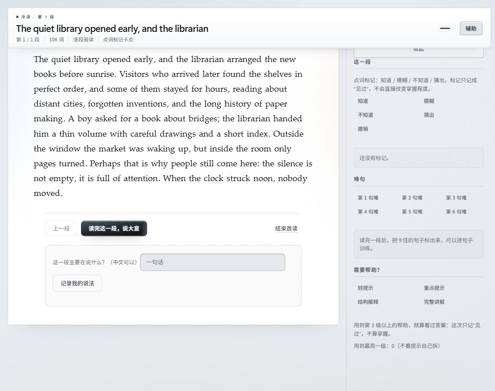
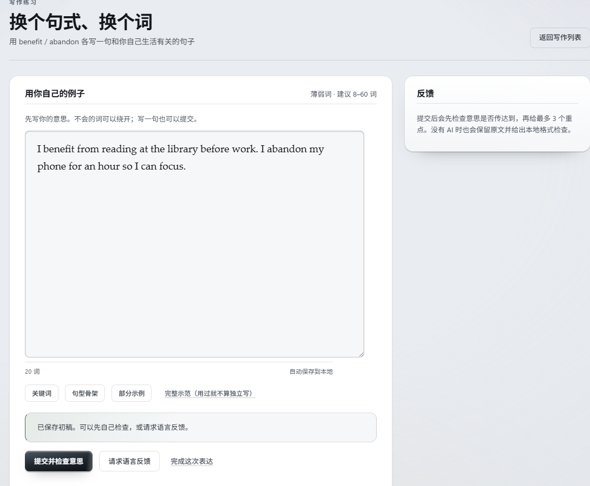

# 词间

**Cijian — Personal English Learning**

从记住单词，到真正理解和使用英语。

词间是一个本地优先的个人英语学习工具。它把词汇记忆、句子理解、阅读、真实英语输入和表达练习连在一起，并根据你的时间与薄弱环节，安排今天更值得做的事。

本地优先 · 无需账号 · AI 可选 · 当前发布面向 Windows 桌面

[快速开始](#快速开始windows) · [功能](#你可以用它做什么) · [界面](#界面)


*今天：可用时间、下一项任务和整条学习路线都在同一屏。*

---

## 为什么做词间

背单词软件很容易让人以为“认识”了很多词，但阅读时仍然想不起来，表达时仍然用不出去。

读文章时查了很多词，合上文章却说不清句子是怎么组织的。

学了很久，却不知道自己到底弱在词汇、结构、阅读，还是表达。

词间不把“看过”当成“学会”。每一次学习都会留下证据：你是独立想起来的，还是看了提示；是读懂了，还是只扫过一遍。

## 你可以用它做什么

| 能力 | 词间怎么帮你 |
| --- | --- |
| **词汇** | 先预览建立印象，再双向回忆；根据对错、反应时间和复习间隔安排下一次。 |
| **句子** | 从主干开始，再认修饰、从句和非谓语；卡住的句子可以继续练，也可以回到语法知识图谱。 |
| **阅读** | 逐段阅读，标记生词和难句，按需获取分级帮助；阅读记录只算“接触”，不会自动变成掌握。 |
| **输入** | 保存真实链接和字幕，观看前冷测、观看后复盘；观看时长只记为曝光，不生成假的“听力分数”。 |
| **表达** | 从一句话开始，先表达再修正；需要时逐级获取提示，照抄示范不会被算作独立掌握。 |
| **计划** | 按可用时间、当前状态、到期复习和手头真实材料生成计划；没有材料就不排任务。 |
| **反馈** | 词汇、语法、阅读、输入、表达分域统计；样本不足时显示“不可评估”，不造一个英语总分。 |

## 界面

### 词汇练习

英译中与中译英双向出题。答错、超时或想不起来的词会在当轮稍后重测；每次作答的反应时间会参与之后的复习安排。


### 阅读

逐段阅读真实英文，点词标记“知道 / 模糊 / 不知道 / 猜出”，把卡住的句子收进句子训练。默认不显示全文翻译，只有你主动请求时才给分级帮助。



### 表达

用自己的生活造句，先用英语把意思送出去，再检查哪里影响了理解。没有配置 AI 时，也能保留原文并做本地确定性检查。



## 设计理念

> 认识一个词，不等于能想起来；能读懂一句话，不等于能独立表达。

所以词间把学习拆成四步：**认识 → 回忆 → 理解 → 使用**。

只有回忆与独立使用产生的证据，才会真正推动掌握度；阅读和观看留下的是接触与理解，不会自动变成“学会”。这里没有连续打卡惩罚，没有虚构等级，也没有为了好看而生成的成长曲线。

## 快速开始（Windows）

### 1. 取得完整项目

```bash
git clone https://github.com/Huyaen/english-reconstruction-system.git
cd english-reconstruction-system
```

也可以直接下载仓库 ZIP，解压完整目录。不要只提取 `index.html`。

### 2. 确认 Node.js

需要 Node.js 18 或更高版本：

```bash
node -v
```

### 3. 启动

双击 `启动词间.cmd`。它会在后台启动本地服务，并自动打开浏览器。

- 地址固定为 **http://localhost:4173**
- 停止服务：双击 `停止词间.cmd`
- 不需要 `npm install`，发布目录里已经包含构建好的 `dist`

### 4. 导入词书

在「词库」里选择 TXT、CSV、TSV、XLSX、XLS 或 JSON 文件。最简单的 CSV：

```csv
word,meaning
abandon,放弃；抛弃
benefit,好处；受益
candidate,候选人
```

字段支持中英文别名。导入前会显示预览；同一次导入中英文相同的词只保留第一条。

### 5. 生成今天的学习计划

打开「今天」，选择今天能空出来的时间，生成计划。计划只会安排装得下的任务；没有真实材料时，不会凭空生成阅读或输入任务。

### 其他系统

macOS / Linux 可以在项目目录手动运行：

```bash
node server.mjs
```

然后访问 http://localhost:4173。当前发布只在 Windows 上做过完整冒烟，其他系统尚未宣称全面适配。

## AI 是可选的

不配置 AI，也可以使用词库、复习、每日计划、句子拆解、阅读、写作和学习报告。

配置一个 OpenAI-compatible 的 Chat Completions 服务后，可以额外使用定向句子、强化阅读和表达反馈。

关于 AI 的边界：

- AI 生成内容不代表已经人工核对。
- AI 句子的结构默认是未验证的，不能直接当作语法掌握证据。
- AI 文章是练习材料，不会冒充真实语料。
- 请求只发送当次功能需要的内容：目标词、语法点、主题、文本，或生成学习报告所需的汇总指标与弱词摘要；不会发送完整词库、逐题记录或备份文件。

## 数据与隐私

- 学习记录保存在当前浏览器的 IndexedDB 中。词间没有云端服务器，学习记录不会上传。
- 不需要创建云端账号。
- 「设置与备份 → 导出全部学习数据」可以导出 JSON 备份；备份不包含 AI 密钥。
- 恢复备份会替换当前学习数据。建议先导出旧数据，再执行恢复。
- 使用外部 AI 时，必要的请求内容会发送给你配置的那个服务商。
- 如果勾选“记住密钥”，密钥会以明文保存在本机 IndexedDB 中，它不是加密保险箱。
- 清理浏览器站点数据、使用无痕模式或更换浏览器配置，都可能让本地记录消失。请定期备份。

### 地址就是数据边界

请固定使用 `http://localhost:4173`。`127.0.0.1:4173`、其他端口和其他浏览器都是不同的存储空间，切换后看到的是另一个空库，不是数据丢了。

## 项目现状与限制

当前发布版本：**v1.0.0**（2026-11-01）。

- 需要本地 Node.js 运行环境，不是托管网页服务。
- 学习数据在浏览器里，必须自己定期备份；换设备时用备份恢复。
- 部分 AI 功能需要自行配置兼容服务；发布时未对真实供应商做质量验收。
- 阅读截图 OCR 面向单篇阅读材料，不支持整本 PDF 词书的 OCR。
- 界面以桌面为主；移动端只保证不溢出、不重叠，未做专门的移动端构图。
- 本仓库目前未附带开源许可证。公开可见不等于授权复制、修改或再分发。

<details>
<summary>开发者入口</summary>

### 技术栈

TypeScript、Vite、原生 DOM、IndexedDB、SheetJS、ts-fsrs、tesseract.js（浏览器本地 OCR）。没有前端框架，也没有账户系统。

### 开发与构建

```bash
npm ci
npm run dev      # 开发服务器 http://127.0.0.1:4173（与正式数据不同源）
npm test         # node:test + tsx
npm run build    # 类型检查、生产构建、写入 PWA 缓存指纹
npm start        # 本地静态服务，读取 dist
```

### CI

GitHub Actions 在 Node 22 / 24 上运行类型检查、全量测试、生产构建，并检查提交的 `dist` 与源码重建结果一致，以及生产包不包含测试钩子。

### 更多文档

- [使用与启动指南](docs/USER_START_GUIDE.md)
- [备份与恢复](docs/BACKUP_AND_RESTORE.md)
- [常见问题](docs/TROUBLESHOOTING.md)
- [产品行为契约](PRODUCT.md)
- [视觉与动效契约](DESIGN.md)
- [变更记录](CHANGELOG.md)
- [v1.0.0 发布报告](docs/RELEASE_V1.0.0.md)

更完整的规格、阶段记录和验收报告在 `PROJECT_SPEC.md`、`AGENT_EXECUTION.md` 与 `docs/` 中。仓库名 `english-reconstruction-system` 沿用早期工程名，产品名为「词间」。

</details>
